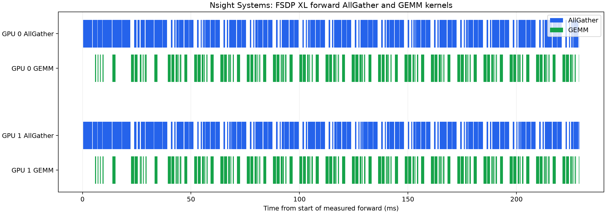

# A2 FSDP experiment: two RTX 6000D GPUs

This records the FSDP implementation and the experiments requested in Sections 7 and 7's `fsdp_accounting` problem of the Spring 2026 Assignment 2 handout.

## What was tested

- The FSDP wrapper shards the assignment model's `Linear` and `Embedding` weights. Small normalization parameters stay replicated and have their gradients averaged.
- Forward weights are all-gathered asynchronously. A forward hook starts gathering a weight two wrapped layers ahead; the current layer waits for its gathered weight when it needs it. Backward gathers weights again and reduce-scatters gradients.
- The asynchronous reduce-scatter result is assigned to `parameter.grad` only after `finish_gradient_synchronization()` waits for the collective. Returning the output tensor directly from autograd let autograd consume it before NCCL had finished writing it.

Implementation: [`FSDP.py`](../../cs336_systems/FSDP.py). Measurement script: [`benchmark_fsdp_accounting.py`](benchmark_fsdp_accounting.py).

## Correctness

The official `tests/test_fsdp.py` suite passed five consecutive runs on this node. Each run had four passing cases: FP32 and FP16 training correctness, plus FP32 and FP16 gradient synchronization, for 20/20 case-runs total. The tests use two Gloo ranks. A compact record is in [`test_results.json`](test_results.json).

I also ran a two-rank NCCL gradient comparison against a full-batch single-process model. Every sharded gradient matched its corresponding baseline slice; the largest absolute error across the tested parameters was `4.5e-8`. A separate NCCL smoke test then ran three SGD steps and compared all reconstructed parameters with the baseline after each step; it passed.

## Setup

| Setting | Value |
| --- | --- |
| GPUs | 2 × NVIDIA RTX 6000D, one node |
| PyTorch | 2.12.1+cu130 |
| Nsight Systems | 2025.3.1.0 |
| Model | XL: `d_model=2560`, `d_ff=10240`, 32 layers, 32 heads, vocabulary 10,000 |
| Precision | FP32; TF32 disabled |
| Batch / context | Global batch 4, local batch 2 per rank, context length 512 |
| Optimizer | `torch.optim.AdamW` |
| Timing | 2 warmup steps and 5 measured steps; CUDA synchronized around each measurement |

The repository currently declares `torch~=2.11.0`; this node had PyTorch 2.12.1+cu130 preinstalled. Both modes ran in the same environment, so the relative comparison is controlled, but this version difference should be kept in mind when reproducing the numbers.

## Memory accounting

The handout's first-order estimate counts persistent FP32 weights, gradients, and AdamW's two state tensors. For `P` parameters that is `16P` bytes per rank without FSDP and `8P` bytes with two-way FSDP, so the expected persistent-memory saving is about **25.38 GiB per rank** for this XL model. The estimate ignores temporary all-gather buffers as requested.

Measured CUDA allocated memory, in GiB per rank (1 GiB = 2^30 bytes):

| Measurement | DDP + AdamW | FSDP + AdamW |
| --- | ---: | ---: |
| After model/wrapper and optimizer initialization | 25.52 | 6.42 |
| Peak through forward and backward, before optimizer step | 38.59 | 25.81 |
| Current allocation immediately before optimizer step | 38.31 | 12.88 |
| Peak during the first optimizer step | 76.57 | 31.93 |
| Current allocation after that step | 63.75 | 25.58 |

The first optimizer step includes lazy AdamW state allocation. The measured first-step peak fell by **44.64 GiB per rank (58.3%)** with FSDP. The measured drop exceeds the 25.38 GiB persistent-state estimate because the DDP measurement also includes reducer buckets and optimizer-step temporary allocations; those temporary components were not separately attributed. The tensor-byte counters confirm the expected sharding: parameters and gradients fell from about 12.69 GiB each to 6.35 GiB each, while AdamW state fell from 25.38 GiB to 12.69 GiB per rank.

Raw per-rank measurements are in [`ddp.json`](ddp.json) and [`fsdp.json`](fsdp.json).

## Iteration time and all-gather overlap

| Mode | Mean measured iteration |
| --- | ---: |
| DDP + AdamW | 936.7 ms |
| FSDP + AdamW | 1,375.1 ms |

FSDP took about **46.8% longer per iteration** in this setup. The Nsight Systems trace shows overlap, but not enough to hide all communication. In the measured forward on each GPU, the union of AllGather kernel intervals was about 168 ms and the GEMM-kernel union about 102 ms; about 56.7 ms of AllGather activity overlapped GEMM activity, or **33.8% of the AllGather timeline**. This is kernel-interval overlap, not a claim that every weight was ready before its consumer; the slower end-to-end iteration also shows remaining overhead.

The image below is a timeline plot generated from Nsight Systems' exported SQLite trace. The raw `.nsys-rep` report and SQLite export are included so the trace can be inspected in Nsight Systems or queried again.

Artifacts: [`fsdp_trace_clean.nsys-rep`](fsdp_trace_clean.nsys-rep), [`fsdp_trace_clean.sqlite`](fsdp_trace_clean.sqlite), [`nsys_kernel_summary.csv`](nsys_kernel_summary.csv), and [`nsys_overlap.json`](nsys_overlap.json). This node was headless, so the visual is a plotted export from the Nsight CLI trace rather than a screenshot of the Nsight graphical interface; the raw report is included for opening in Nsight Systems.

## Experiment status against the handout

| Handout item | Status |
| --- | --- |
| FSDP wrapper, weight all-gather, gradient reduce-scatter, FP32 master weights | Implemented and tested |
| Official FSDP tests, repeated five times | Complete, 20/20 case-runs passed |
| Expected peak-memory savings estimate | Complete |
| XL model, two-GPU memory and iteration-time profile | Complete |
| Nsight all-gather/compute overlap analysis | Complete; raw trace and derived timeline included (no GUI screenshot on headless node) |

